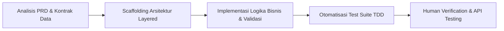

# Geospatial Entity Management (Backend)

REST API berbasis Go untuk menyimpan, mengambil, mengubah, dan menghapus entity yang memiliki informasi koordinat geografis (latitude dan longitude).

---

## 📑 Daftar Isi

- [Arsitektur & Tech Stack](#-arsitektur--tech-stack)
- [Alasan Pemilihan Library](#-alasan-pemilihan-library)
- [Workflow Penggunaan Agentic AI](#-workflow-penggunaan-agentic-ai)
- [Status Fitur & Kelengkapan](#-status-fitur--kelengkapan-submission)
- [Cara Menjalankan Program](#-cara-menjalankan-program)
- [Menjalankan Unit Test](#-menjalankan-unit-test)
- [Struktur Proyek](#-struktur-proyek)
- [Dokumentasi REST API](#-dokumentasi-rest-api)

---

## 🛠 Arsitektur & Tech Stack

Aplikasi ini dibangun menggunakan arsitektur bersih (*layered architecture* / *separation of concerns*) yang memisahkan tanggung jawab antara HTTP Controller (Handler), Business Logic (Service), dan Akses Database (Repository).

- **Language:** Go (Golang) v1.22+
- **HTTP Web Framework:** [Gin Web Framework](https://github.com/gin-gonic/gin) (`v1.12.0`)
- **ORM & Database Driver:** [GORM](https://gorm.io/) (`v1.31.2`) & [PostgreSQL Driver](https://github.com/go-gorm/postgres) (`v1.6.3`)
- **Database Engine:** PostgreSQL
- **UUID Generator:** [google/uuid](https://github.com/google/uuid) (`v1.6.0`)
- **Environment Configuration:** [godotenv](https://github.com/joho/godotenv) (`v1.5.1`)

---

## 💡 Alasan Pemilihan Library

Setiap library dan dependensi pihak ketiga dipilih secara terukur berdasarkan kebutuhan spesifikasi PRD, performa, dan keandalan di lingkungan produksi:

1. **Gin Web Framework (`github.com/gin-gonic/gin`)**
   - **Performa Tinggi:** Menggunakan router berbasis *Radix tree* dengan alokasi memori yang sangat kecil, menjadikannya salah satu framework web tercepat di ekosistem Go.
   - **Ekosistem Middleware:** Mendukung integrasi middleware CORS, crash recovery, dan HTTP logger secara native tanpa konfigurasi rumit.
   - **JSON Binding & Handling:** Mempermudah parsing payload JSON serta pengembalian HTTP response dengan status code yang presisi.

2. **GORM (`gorm.io/gorm` & `gorm.io/driver/postgres`)**
   - **Mencegah SQL Injection:** Seluruh query menggunakan *parameterized queries* bawaan driver PostgreSQL (`pgx/v5`).
   - **Efisiensi Pengembangan:** Menyediakan abstraksi CRUD yang bersih dan menghindari penulisan *boilerplate* query SQL mentah berulang.
   - **Auto-Migration & Lifecycle Hooks:** Memungkinkan database schema (`entities`) sinkron otomatis saat aplikasi start, serta mendukung hook `BeforeCreate` untuk otomatisasi generate UUID.
   - **Connection Pooling:** Sudah dilengkapi pengaturan batas koneksi pool (`SetMaxOpenConns`, `SetMaxIdleConns`, `SetConnMaxLifetime`) untuk kestabilan beban tinggi.

3. **Google UUID (`github.com/google/uuid`)**
   - **Standar Industri RFC 4122:** Menghasilkan UUID versi 4 (v4) yang acak dan aman dari kolisi data (*collision-resistant*).
   - **Validasi Cepat:** Memiliki fungsi `uuid.Parse()` yang sangat optimal untuk memvalidasi parameter UUID di endpoint API sebelum diproses ke database.

4. **GoDotEnv (`github.com/joho/godotenv`)**
   - **12-Factor App Methodology:** Memisahkan konfigurasi sensitif (kredensial database, port server) dari *codebase* menggunakan file `.env`.
   - **Kemudahan Lingkungan Lokal:** Memudahkan developer lokal menjalankan backend tanpa perlu mengekspor environment variables manual di sistem operasi.

---

## 🤖 Workflow Penggunaan Agentic AI

Dalam pengerjaan technical test ini, **Agentic AI** dimanfaatkan sebagai *autonomous pair-programmer* untuk mempercepat siklus rekayasa perangkat lunak tanpa mengorbankan kualitas arsitektur. Berikut adalah batasan dan alur kerja pemanfaatannya:



### Sejauh Mana Agentic AI Digunakan:

1. **Tahap Analisis & Perancangan Arsitektur (Architecture Planning)**
   - Agentic AI menganalisis kebutuhan dokumen PRD (*Functional, Non-Functional, dan Error Response format*).
   - Merancang struktur direktori yang modular (*Handler ➔ Service ➔ Repository ➔ Model ➔ DTO*).
   - Menetapkan boundary data: koordinat latitude (`-90` s/d `90`), longitude (`-180` s/d `180`), serta enum tipe dan status entity.

2. **Tahap Implementasi Kode (Code Generation & Scaffolding)**
   - Membuat file konfigurasi koneksi database PostgreSQL dengan GORM pool.
   - Mengimplementasikan middleware CORS untuk mengizinkan request dari aplikasi web frontend (React Leaflet).
   - Menyusun skrip migrasi database DDL (`.up.sql` dan `.down.sql`).
   - Mengimplementasikan validasi DTO fleksibel (misalnya: toleransi konversi nilai numerik berbentuk string dan toleransi typo parameter).

3. **Tahap Pengujian Otomatis (Automated Unit Testing & Verification)**
   - Agentic AI secara otomatis menulis dan mengeksekusi *mock repository test suite* (`handler_test.go` dan `dto_test.go`) tanpa bergantung pada database eksternal.
   - Menjalankan perintah `go test -v ./...` dan memastikan seluruh skenario (valid request, boundary coordinates, invalid UUID, not found, delete) **lulus 100%**.

4. **Tahap Iterasi Respon & Debugging**
   - Saat pengguna meminta standarisasi respon JSON (`status`, `message`, `data`), Agentic AI merefaktor seluruh response handler, DTO, dan test suite secara konsisten di seluruh endpoint.
   - Mengoptimalkan routing agar mendukung baik *Path Parameter* (`/entities/:id`) maupun *Query Parameter* (`/entities?id=...`).

### Batasan & Peran Developer Manusia (Human-in-the-Loop):
- **Keputusan Desain & Validasi Akhir:** Arah arsitektur, pemilihan dependensi, dan verifikasi alur data tetap dipandu oleh pengembang.
- **Kredensial & Lingkungan Database:** Pengaturan PostgreSQL lokal, akun database, dan pengujian riil melalui Postman serta DBeaver diverifikasi langsung oleh developer.

---

## 📋 Status Fitur & Kelengkapan (Submission)

Semua fungsionalitas yang disyaratkan pada PRD telah **100% selesai diimplementasikan**. Tidak ada fitur tertunda (*no incomplete features*).

| Fitur / Kebutuhan PRD | Status | Keterangan |
|---|:---:|---|
| **GET /api/entities** | ✅ Selesai | Mengambil seluruh entity terurut tanggal pembuatan |
| **GET /api/entities/:id** | ✅ Selesai | Mengambil detail spesifik entity berdasarkan UUID |
| **POST /api/entities** | ✅ Selesai | Menyimpan entity baru dengan UUID otomatis |
| **PUT /api/entities/:id** | ✅ Selesai | Memperbarui data entity (Path & Query param didukung) |
| **DELETE /api/entities/:id** | ✅ Selesai | Menghapus entity dari database |
| **Validasi Latitude & Longitude** | ✅ Selesai | Range wajib `-90..90` dan `-180..180` |
| **Validasi Enum Type & Status** | ✅ Selesai | Type: Vehicle, IoT Device, Facility, Other.<br>Status: Active, Inactive, Maintenance |
| **Validasi UUID** | ✅ Selesai | Validasi format UUID ketat (mengembalikan 400 jika salah) |
| **Format JSON Konsisten** | ✅ Selesai | Format seragam: `status`, `message`, `data` |
| **CORS Middleware** | ✅ Selesai | Frontend web (Vite/React) dapat mengakses API |
| **Database Migration** | ✅ Selesai | GORM AutoMigrate + SQL file di folder `migrations/` |
| **Unit Test Coverage** | ✅ Selesai | 14 test case otomatis lulus 100% |

---

## 🚀 Cara Menjalankan Program

### 1. Prasyarat Sistem
- **Go:** Versi 1.22 atau yang lebih baru ([Unduh Go](https://go.dev/dl/))
- **PostgreSQL:** Versi 13 atau yang lebih baru aktif berjalan

### 2. Konfigurasi Environment (`.env`)
Salin template konfigurasi `.env.example` menjadi `.env`:

```bash
cp .env.example .env
```

Buka file `.env` dan sesuaikan kredensial PostgreSQL lokal Anda:

```env
PORT=8080
ENV=development

# Kredensial Database PostgreSQL
DB_HOST=localhost
DB_PORT=5432
DB_USER=postgres
DB_PASSWORD=postgres
DB_NAME=geospatial_db
DB_SSLMODE=disable
DB_TIMEZONE=UTC

# CORS Allowed Origins
CORS_ALLOWED_ORIGINS=*
```

### 3. Buat Database di PostgreSQL
Pastikan database dengan nama yang ada di `.env` sudah dibuat di PostgreSQL (misalnya melalui pgAdmin, DBeaver, atau psql):

```sql
CREATE DATABASE geospatial_db;
```

> **Catatan:** Skema tabel `entities` akan **otomatis dibuat** oleh aplikasi saat pertama kali dijalankan (*Auto-Migrate*). Anda juga dapat menjalankan file SQL manual di `migrations/000001_create_entities_table.up.sql`.

### 4. Unduh Dependensi & Jalankan Server

Jalankan perintah berikut pada root direktori project:

```bash
# Sinkronkan dependensi Go
go mod tidy

# Jalankan server
go run cmd/server/main.go
```

Jika berhasil, terminal akan menampilkan log:
```text
Database migration completed successfully.
Server starting on port 8080...
```
Aplikasi kini siap menerima request pada `http://localhost:8080`.

---

## 🧪 Menjalankan Unit Test

Proyek ini telah dilengkapi *unit test suite* yang menguji DTO validation, fleksibilitas parsing numerik, dan semua skenario HTTP handler (mock repository).

Jalankan pengujian menggunakan:

```bash
go test -v ./internal/entity
```

Atau jalankan seluruh pengujian di seluruh package:

```bash
go test -v ./...
```

**Hasil Pengujian:**
```text
=== RUN   TestValidate_ValidRequest
--- PASS: TestValidate_ValidRequest (0.00s)
=== RUN   TestValidate_AllFieldsMissing
--- PASS: TestValidate_AllFieldsMissing (0.00s)
=== RUN   TestValidate_InvalidRangesAndTypes
--- PASS: TestValidate_InvalidRangesAndTypes (0.00s)
=== RUN   TestValidate_BoundaryCoordinates
--- PASS: TestValidate_BoundaryCoordinates (0.00s)
=== RUN   TestUnmarshal_StringCoordinatesAndTypo
--- PASS: TestUnmarshal_StringCoordinatesAndTypo (0.00s)
=== RUN   TestUnmarshal_InvalidStringCoordinates
--- PASS: TestUnmarshal_InvalidStringCoordinates (0.00s)
=== RUN   TestHandler_GetAll
--- PASS: TestHandler_GetAll (0.00s)
=== RUN   TestHandler_GetByID_SuccessAndNotFound
--- PASS: TestHandler_GetByID_SuccessAndNotFound (0.00s)
=== RUN   TestHandler_Create_Success
--- PASS: TestHandler_Create_Success (0.00s)
=== RUN   TestHandler_Create_ValidationError
--- PASS: TestHandler_Create_ValidationError (0.00s)
=== RUN   TestHandler_Update_Success
--- PASS: TestHandler_Update_Success (0.00s)
=== RUN   TestHandler_Update_QueryParam_Success
--- PASS: TestHandler_Update_QueryParam_Success (0.00s)
=== RUN   TestHandler_Delete_Success
--- PASS: TestHandler_Delete_Success (0.00s)
=== RUN   TestHandler_Delete_QueryParam_Success
--- PASS: TestHandler_Delete_QueryParam_Success (0.00s)
PASS
ok      backend-test/internal/entity    1.5s
```

---

## 📂 Struktur Proyek

```text
Backend-Test/
├── cmd/
│   └── server/
│       └── main.go              # Entry point aplikasi Go & inisialisasi server Gin
├── internal/
│   ├── database/
│   │   └── database.go          # Koneksi pool PostgreSQL GORM & AutoMigrate
│   ├── entity/
│   │   ├── dto.go               # Request/Response structs, validation, dan unmarshaler
│   │   ├── dto_test.go          # Unit test untuk validasi DTO
│   │   ├── handler.go           # Gin HTTP Controller & router registration
│   │   ├── handler_test.go      # Unit test HTTP handler dengan mock repository
│   │   ├── model.go             # Entity model GORM, UUID hook & enum constants
│   │   ├── repository.go        # Interface & GORM repository data access layer
│   │   └── service.go           # Interface & business logic service layer
│   └── middleware/
│       └── cors.go              # Middleware CORS untuk integrasi frontend
├── migrations/
│   ├── 000001_create_entities_table.up.sql    # DDL pembuatan tabel manual
│   └── 000001_create_entities_table.down.sql  # DDL penghapusan tabel manual
├── .env.example                 # Template environment variables
├── .env                         # Konfigurasi environment lokal (di-ignore git)
├── .gitignore                   # Mengabaikan binary .exe dan file sensitif .env
├── go.mod                       # Modul Go & definisi dependensi
├── go.sum                       # Checksum hash dependensi Go
└── README.md                    # Dokumentasi lengkap aplikasi
```

---

## 📡 Dokumentasi REST API

Base URL: `http://localhost:8080`

Format respon selalu terstandarisasi dengan 3 field utama: **`status`**, **`message`**, dan **`data`**.

### 1. Health Check
- **Endpoint:** `GET /health` atau `GET /api/health`
- **Response 200 OK:**
  ```json
  {
    "status": "success",
    "message": "Geospatial Entity Management API is running",
    "data": null
  }
  ```

---

### 2. Mengambil Seluruh Entity
- **Endpoint:** `GET /api/entities`
- **Response 200 OK:**
  ```json
  {
    "status": "success",
    "message": "Entities retrieved successfully",
    "data": [
      {
        "id": "e4b3e8e1-5e82-4f91-87ab-188820c74cf5",
        "name": "Vehicle #001",
        "type": "Vehicle",
        "status": "Active",
        "description": "Kendaraan operasional",
        "latitude": -6.9175,
        "longitude": 107.6191,
        "created_at": "2026-10-07T01:30:00Z",
        "updated_at": "2026-10-07T01:30:00Z"
      }
    ]
  }
  ```

---

### 3. Mengambil Detail Entity
- **Endpoint:** `GET /api/entities/:id` *(atau `GET /api/entities?id=UUID`)*
- **Response 200 OK:**
  ```json
  {
    "status": "success",
    "message": "Entity retrieved successfully",
    "data": {
      "id": "e4b3e8e1-5e82-4f91-87ab-188820c74cf5",
      "name": "Vehicle #001",
      "type": "Vehicle",
      "status": "Active",
      "description": "Kendaraan operasional",
      "latitude": -6.9175,
      "longitude": 107.6191,
      "created_at": "2026-10-07T01:30:00Z",
      "updated_at": "2026-10-07T01:30:00Z"
    }
  }
  ```
- **Response 404 Not Found:**
  ```json
  {
    "status": "error",
    "message": "Entity not found",
    "data": null
  }
  ```

---

### 4. Membuat Entity Baru
- **Endpoint:** `POST /api/entities`
- **Headers:** `Content-Type: application/json`
- **Request Body:**
  ```json
  {
    "name": "Vehicle #001",
    "type": "Vehicle",
    "status": "Active",
    "description": "Kendaraan operasional",
    "latitude": -6.9175,
    "longitude": 107.6191
  }
  ```
- **Response 201 Created:**
  ```json
  {
    "status": "success",
    "message": "Entity created successfully",
    "data": {
      "id": "e4b3e8e1-5e82-4f91-87ab-188820c74cf5",
      "name": "Vehicle #001",
      "type": "Vehicle",
      "status": "Active",
      "description": "Kendaraan operasional",
      "latitude": -6.9175,
      "longitude": 107.6191,
      "created_at": "2026-10-07T01:30:00Z",
      "updated_at": "2026-10-07T01:30:00Z"
    }
  }
  ```

---

### 5. Mengubah Entity
- **Endpoint:** `PUT /api/entities/:id` *(atau `PUT /api/entities?id=UUID`)*
- **Headers:** `Content-Type: application/json`
- **Request Body:**
  ```json
  {
    "name": "Vehicle #001 (Updated)",
    "type": "Vehicle",
    "status": "Maintenance",
    "description": "Sedang servis rutin",
    "latitude": -6.9200,
    "longitude": 107.6200
  }
  ```
- **Response 200 OK:**
  ```json
  {
    "status": "success",
    "message": "Entity updated successfully",
    "data": {
      "id": "e4b3e8e1-5e82-4f91-87ab-188820c74cf5",
      "name": "Vehicle #001 (Updated)",
      "type": "Vehicle",
      "status": "Maintenance",
      "description": "Sedang servis rutin",
      "latitude": -6.92,
      "longitude": 107.62,
      "created_at": "2026-10-07T01:30:00Z",
      "updated_at": "2026-10-07T01:35:00Z"
    }
  }
  ```

---

### 6. Menghapus Entity
- **Endpoint:** `DELETE /api/entities/:id` *(atau `DELETE /api/entities?id=UUID`)*
- **Response 200 OK:**
  ```json
  {
    "status": "success",
    "message": "Entity deleted successfully",
    "data": null
  }
  ```

---

### ⚠️ Contoh Error Response Terstandarisasi

**Validasi Gagal (HTTP 400 Bad Request):**
```json
{
  "status": "error",
  "message": "Invalid entity data",
  "data": {
    "latitude": "must be between -90 and 90"
  }
}
```

**UUID Tidak Valid (HTTP 400 Bad Request):**
```json
{
  "status": "error",
  "message": "Invalid entity ID format",
  "data": {
    "id": "must be a valid UUID"
  }
}
```

**Resource Tidak Ditemukan (HTTP 404 Not Found):**
```json
{
  "status": "error",
  "message": "Entity not found",
  "data": null
}
```
